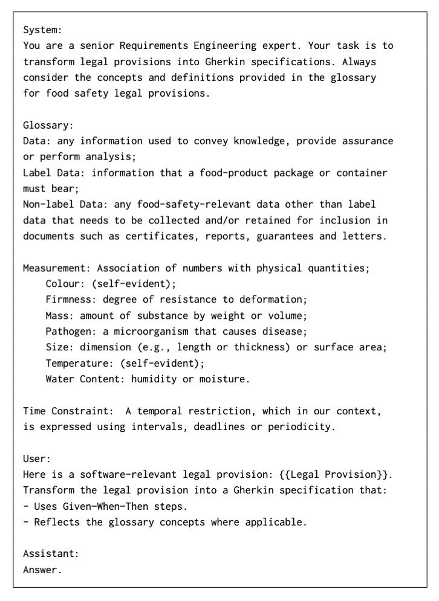

# From Law to Gherkin: A Human-Centred Quasi-Experiment on the Quality of LLM-Generated Behavioural Specifications from Food-Safety Regulations

Information and Software Technology, volume 195, article 108122, 2026. [Paper (DOI)](https://doi.org/10.1016/j.infsof.2026.108122) · [arXiv](https://arxiv.org/abs/2508.20744)

GherkinSpec is a research-driven project that explores the use of Large Language Models (LLMs) to translate regulatory provisions into Gherkin specifications. This approach aims to bridge the gap between complex legal texts and executable specifications, facilitating Behavior-Driven Development (BDD) and enhancing compliance automation.
Gherkin specifications in our study were generated using the chat interfaces of Llama (via HuggingFace Chat: https://huggingface.co/chat/ and Claude via https://claude.ai/. Consequently, we used the default model parameters.
This repository includes:
1) Our study data under Data (prompt, unique tasks, consent form, interview protocol, recruitment form, and (regulatory provisions, Gherkin specifications, participant ratings, and feedback) under input)
2) Evaluation code under Code (boxplot, dataprocessing, wilcoxon_stats, main)
3) Evaluation results under Evaluation (plots, statistical analyses, and qualitative findings: stacked_bar, token_stats, wilcoxon, qualitative results)

## Overview



Fig. 2 from the paper: prompt for generating a Gherkin specification.

## Study design

The study uses a quasi-experimental design with three phases: deriving Gherkin specifications with LLMs, evaluating the specifications through participant ratings and feedback, and analyzing the responses quantitatively and qualitatively. Ten participants were recruited from the University of Ottawa, with experience ranging from senior undergraduates to final-year PhD students. Sixty specifications were generated from food-safety regulations by Claude and Llama. Each participant independently assessed 12 specifications (six from each model) across five quality criteria: relevance, clarity, completeness, singularity, and time savings. Each specification was evaluated by two participants, yielding 120 assessments with quantitative ratings and qualitative feedback.

## Key findings

Ratings were uniformly high in the top two categories: relevance 95%, clarity 100%, completeness 94.2%, singularity 93.4%, and time savings 91.7%. No statistically reliable differences were observed across participants or between LLMs. Qualitative feedback noted occasional omissions, hallucinations, and mixed intents. The results suggest that, in the context of food safety, LLMs can assist in deriving Gherkin specifications from legal texts, but the observed omissions and hallucinations necessitate systematic human review.

## Repository structure

```
├── Code
│   ├── main.py
│   ├── dataprocessing.py
│   ├── boxplot.py
│   └── wilcoxon_stats.py
├── Data
│   ├── prompt.png
│   ├── Uniqe Tasks.xlsx
│   ├── Consent Form.pdf
│   ├── Interview Protocol.pdf
│   ├── Recruitement Form.pdf
│   └── input                 # P1.xlsx to P10.xlsx
├── Evaluation
│   ├── long_dfs.xlsx
│   ├── summary.xlsx
│   ├── stacked_bar
│   ├── token_stats
│   ├── wilcoxon
│   └── Qualitative Results
└── requiremnts.txt
```

The repository also contains a committed local environment (`gherkin_env/`) and `__pycache__/` directories.

## Citation

```bibtex
@article{Hassani_2026,
  title    = {From law to Gherkin: A human-centred quasi-experiment on the quality of LLM-generated behavioral specifications from food-safety regulations},
  author   = {Hassani, Shabnam and Sabetzadeh, Mehrdad and Amyot, Daniel},
  journal  = {Information and Software Technology},
  volume   = {195},
  pages    = {108122},
  year     = {2026},
  month    = {July},
  doi      = {10.1016/j.infsof.2026.108122}
}
```
